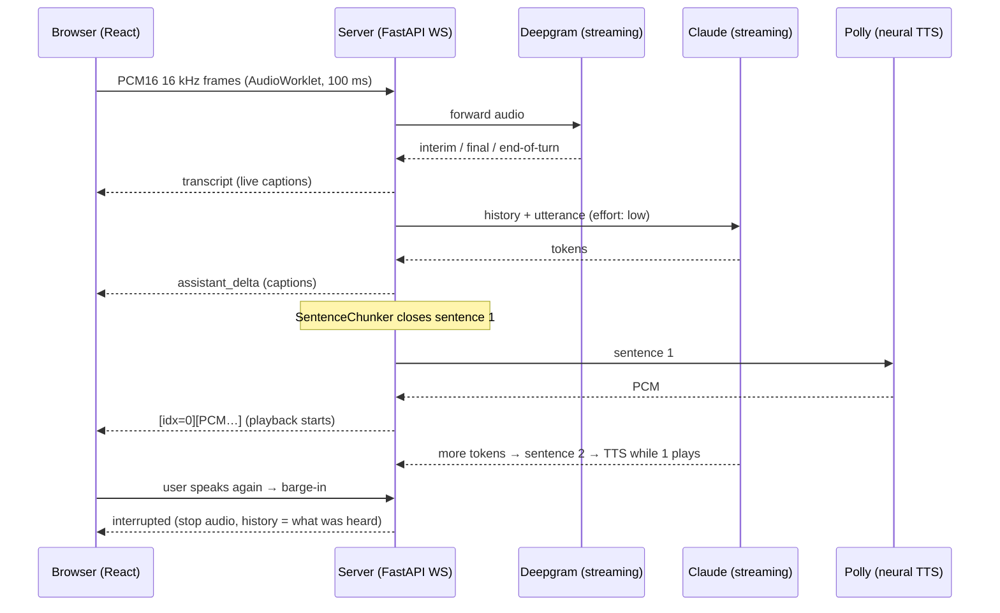

# Real-time Voice Assistant

A full-duplex voice agent. You talk, it streams a transcript, Claude answers token by token,
and the answer is spoken **sentence by sentence while the rest is still being generated**. You
can interrupt it mid-sentence, as you would a person.

The backend is Python (FastAPI WebSockets, asyncio). The frontend is React and TypeScript, with
AudioWorklet capture and gapless Web Audio playback.



## What makes it hard, and how it's handled

| Problem | Approach |
|---|---|
| **Time to first audio** | Speech can't start until there's a complete phrase. `SentenceChunker` emits a sentence the moment it closes, handles abbreviations (`Dr.`) and decimals (`3.14`), merges tiny fragments ("Yes."), and breaks long clauses at a comma. TTS for sentence *N+1* overlaps with playback of sentence *N*. The system prompt tells Claude it's latency-sensitive and to answer in short, spoken-style sentences. |
| **Barge-in** | Any transcript of two or more words that arrives while the assistant is speaking cancels the LLM and TTS tasks (asyncio cancellation) and tells the client to stop playback immediately. |
| **Conversation memory after an interruption** | The client reports the last sentence it **finished playing**. History records only what the user actually heard, plus `[interrupted by user]`, so the next reply doesn't repeat itself or refer to words never spoken. |
| **Echo** | Browser `echoCancellation` handles server mode. In browser-speech mode, interim results that mostly match the sentence currently being spoken are ignored (`isLikelyEcho`). |
| **Gapless streaming audio** | Each PCM chunk is scheduled at `max(now, previousEnd)` on one `AudioContext`. Every frame carries a 4-byte sentence index, so playback progress maps back to the text. |
| **Concurrency on one socket** | Tokens, audio, and STT events all write to the same WebSocket, so a lock serializes writes. Provider failures are sent as `error` events and the session stays alive. |
| **Observability** | Every turn reports server-side first token, first sentence, first audio, and total time, plus client-measured *first audio heard*. These show in the UI. |
| **Runs with zero keys** | Each stage has a fallback: Claude → offline echo, Deepgram → Web Speech recognition, Polly → `speechSynthesis`. The server reports its capabilities on connect and the client adapts. |

## Run it

```bash
# server
cd server && pip install -e ".[dev,aws]"
export ANTHROPIC_API_KEY=...            # optional: offline echo mode without it
export DEEPGRAM_API_KEY=...             # optional: server-side streaming STT
export TTS_PROVIDER=polly               # optional: needs AWS credentials
uvicorn voice.app:app_factory --factory --port 8000

# client (dev, proxies /ws to :8000)
cd web && npm install && npm run dev    # http://localhost:5173
```

You can also run everything as one container, with the client built into the server:

```bash
docker build -t voice-assistant . && docker run -p 8000:8000 --env-file .env voice-assistant
```

Microphone access needs `localhost` or HTTPS. The default model is `claude-opus-5-5` at low
effort. Set `VOICE_MODEL` / `VOICE_EFFORT` to trade quality against latency.

## Protocol

| Direction | Message |
|---|---|
| client → server | binary PCM16 frames · `{"type":"user_text"}` · `{"type":"interrupt","played_index"}` |
| server → client | `ready` (capabilities) · `transcript` · `assistant_delta` · `assistant_sentence` · binary `[u32 index][PCM16]` · `turn_end` (metrics) · `interrupted` · `error` |

## Tests

```bash
cd server && pytest -q   # 12: chunking, ordered audio frames, barge-in history, STT parsing, WS round trip
cd web && npm test       # 6: resampling, PCM16 codec, frame parsing, chunking, echo filter
```

The session tests use scripted LLM and TTS fakes with controlled delays. That makes
interruption timing deterministic: for example, "interrupt after sentence 2 is emitted but only
sentence 1 has been played".

## Why WebSockets and not WebRTC?

WebRTC gives you jitter buffers and Opus, which matters on lossy mobile networks at scale. For
a single-server deployment, a WebSocket carrying 16 kHz PCM keeps the audio path transparent
and easy to test. The provider interfaces (`STTStream`, `TTS`, `LLM`) and the session state
machine don't depend on the transport, so moving to WebRTC (for example, LiveKit) would only
replace `app.py` and `mic.ts`/`player.ts`.
